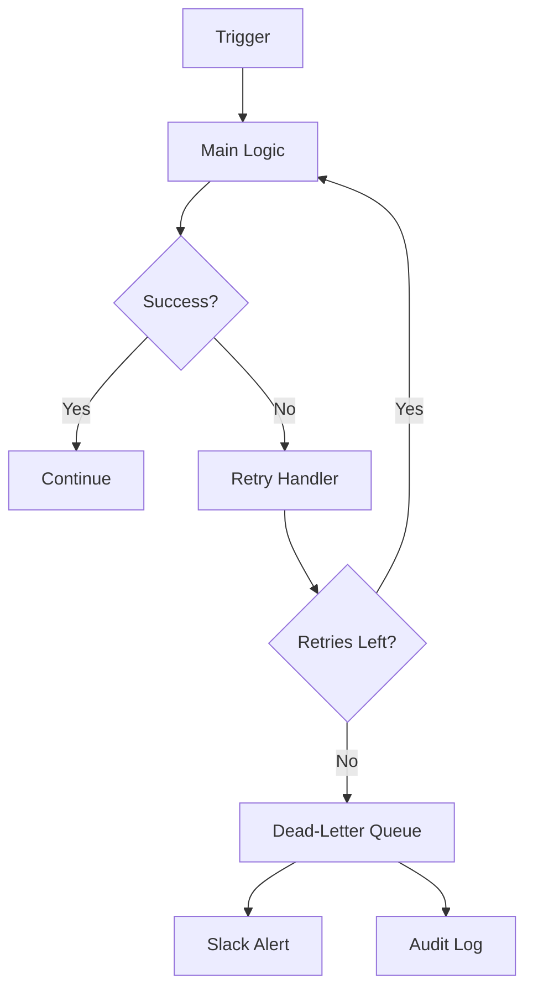

# n8n-error-handling-pattern

> Production-grade error handling patterns for n8n workflows — retry with exponential backoff, dead-letter queue, fallback paths, and audit logging. Importable sub-workflows, zero hardcoded credentials.

**Tested on:** n8n v1.x.x | **License:** MIT | **Status:** Active

---

## What It Does

This repo provides reusable error handling sub-workflows you can import into any n8n instance:

- **Retry with exponential backoff** — 3 retries with configurable delay multiplier
- **Dead-letter queue** — failed items logged to Airtable for manual review
- **Fallback path** — graceful degradation when a downstream service is unavailable
- **Audit logging** — PII-masked execution logs with timestamp and source tracking

## Architecture



## How to Import

1. Download any workflow JSON from the `workflows/` directory
2. In n8n: **Settings → Workflow Templates → Import from file**
3. Configure the credential placeholders listed in each workflow's README section
4. Set `active: true` only after testing with sample payloads from `payloads/`

## Workflows

| File | Pattern | Description |
|------|---------|-------------|
| `retry-with-backoff.json` | Retry + Backoff | 3 retries with exponential delay (1s/2s/4s) |
| `dead-letter-queue.json` | Dead-Letter Queue | Failed items logged for manual review |
| `fallback-path.json` | Fallback Path | Primary → secondary → cached default |
| `audit-logging.json` | Audit Logging | PII-masked execution logs |
| `production-error-handler.json` | Full System | Combines all patterns via sub-workflows |

## Sample Payloads

See `payloads/` directory. Every workflow has a `success.json` and `failure.json` sample.

## Error Handling

Every workflow in this repo IS an error handling pattern. See `docs/architecture.md` for the full design rationale.

## Multi-Platform

| Platform | Coverage |
|----------|---------|
| n8n | Full workflow JSON (importable) |
| Make | `docs/make-equivalent.md` — conceptual rebuild guide |
| Zapier | `docs/zapier-equivalent.md` — conceptual rebuild guide |

## Business Impact

*(Coming in v0.2.0 — will include: time saved on debugging, silent failure reduction metrics)*

## Contributing

See [CONTRIBUTING.md](./CONTRIBUTING.md). All contributions require the pre-submit checklist.

## License

[MIT](./LICENSE) © 2024 Lorenz Espinosa

---

## Quick Start

```bash
# Clone and explore
git clone https://github.com/lorenzespinosa/n8n-error-handling-pattern.git
cd n8n-error-handling-pattern

# Import any workflow into n8n
# 1. Open n8n → Settings → Import from file
# 2. Select a JSON from workflows/
# 3. Configure credential placeholders
# 4. Test with matching payloads from payloads/
```

## Related Projects

- [n8n-legal-ops-templates](https://github.com/lorenzespinosa/n8n-legal-ops-templates) — Law firm workflow templates using these error handling patterns
- [n8n-ai-agent-delegator](https://github.com/lorenzespinosa/n8n-ai-agent-delegator) — Multi-agent AI system using these error handling patterns

---

<!-- hire-cta -->
## 👋 Built by Lorenz Espinosa

I design and ship production automation for ops-heavy businesses — webhook-driven, AI-powered systems with validation, retries, and audit logging baked in. **50+ processes automated · $800K+ saved.**

**Want something like this built for your team?**

[](https://github.com/lorenzespinosa) &nbsp;[](mailto:renzespinosa13@gmail.com?subject=Automation%20project%20inquiry&body=Hi%20Lorenz%2C%0A%0AGoal%3A%0ASystems%2Ftools%20involved%3A%0ATimeline%3A%0A) &nbsp;[](https://www.linkedin.com/in/lorenz-leslie-espinosa/)
